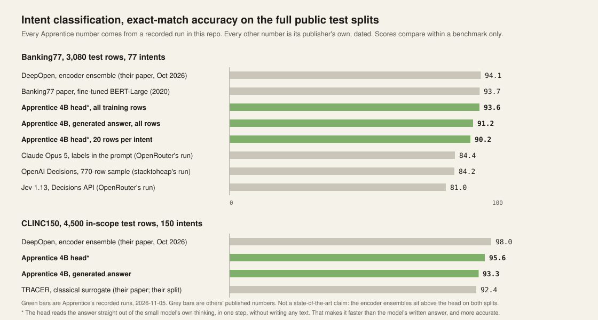

# Task 6: Intent classification with a bounded router (Banking77 and CLINC150)

Two public intent benchmarks, one recipe, every number from a recorded run on 2026-11-04 on an
Apple-silicon Mac (36 GB). This task answers a different question from the others in this
repo: not only "does a fine-tuned small model match the frontier", but "can the small model
decide, per request, whether to answer or hand the request to the frontier, with a proven
ceiling on the error among the answers it keeps".

## Results



### Accuracy on the full public test splits

| System | Banking77 (3,080 rows, 77 intents) | CLINC150 (4,500 in-scope rows, 150 intents) | Who ran it |
|---|---|---|---|
| **Head on our fine-tune** (one matmul on the prefill state, no decoding) | **93.6** (all training rows); 90.2 (20 per intent) | **95.6** | this folder |
| Our fine-tune's generated answer, Qwen3.5-4B 4-bit LoRA, two epochs | 91.2 (all training rows); 81.9 (20 per intent) | 93.3 | this folder |
| Claude Opus 5, labels in the prompt, temperature 0, strict enum | 84.4 | not run | [OpenRouter, 2026](https://openrouter.ai/blog/insights/jev-vs-claude-opus-5-classification/) |
| Jev 1.13, Decisions API choice question | 81.0 | not run | same OpenRouter post |
| TRACER's classical surrogate (their split, OOS handling may differ) | not run | 92.4 | [arXiv 2604.14531](https://arxiv.org/abs/2604.14531) |

Exact-match accuracy, 0 to 100. Format valid on every row of both test splits. Scores compare
within a benchmark only. Banking77 has two runs of the same recipe: 20 examples per intent
(`results/banking77/`, the adapter trained on 1,078 rows) and the whole training split
(`results/banking77_full/`, 7,002 rows after the product's 30% holdout, 2026-11-05). Beside
the Banking77 paper's own full-data numbers (Casanueva et al. 2020, Table 3: fine-tuned
BERT-Large 93.66, USE+ConveRT 93.36), the all-rows head sits 0.09 under BERT-Large. Later
papers report higher: DeepOpen ([arXiv 2610.31104](https://arxiv.org/abs/2610.31104),
October 2026) reaches 94.1 on Banking77 (best of three seeds chosen after test evaluation,
mean 94.0) and 98.0 on in-scope CLINC150 with three DeBERTa-v3-large classifiers and a
specialist fused. This is not a state-of-the-art claim. Decision APIs on the same split,
as run by others: Jev 79.2 on all 3,080 rows ([nibzard's benchmark](https://github.com/nibzard/decision-model-benchmark),
September 2026) and OpenAI Decisions 84.2 on a 770-row sample with two examples per intent
([stacktoheap](https://stacktoheap.com/blog/2026/10/08/jev-the-decisions-strike-back/),
78.96 with definitions only). OpenRouter's own cascade, Jev above 0.9 confidence and Claude
Opus 5 for the rest, answers 75.9% of the rows with Jev and scores 84.0 overall at $0.69 per
thousand; our head alone scores 93.6, and at the 5% bound keeps about 90% of rows at 97.4 to
97.7% accuracy on the kept ones, with the frontier's share of the cost falling to a tenth.
460 test rows
(14.9%) share 80% or more of their tokens with a training row; without them the all-rows
head scores 93.1 and its generated answer 90.6. The routing numbers below use the all-rows
head; the 20-per-intent head kept 70 to 82% (`results/banking77/E3_head_sgr.md`).

### Routing: share of requests the head keeps at a 5% error ceiling

Selection with guaranteed risk (Geifman and El-Yaniv 2017, Theorem 3.2), target risk 5%,
confidence 95%, threshold chosen on one third of the test rows, measured on another third
the rule never saw, three different splits.

| Benchmark | Kept share across three seeds | Realised error among kept (one-sided 95% upper limit) |
|---|---|---|
| Banking77, all-rows head (`results/banking77_full/E3_head_sgr.md`) | 88.8%, 90.1%, 90.6% | 2.6% (3.7%), 2.3% (3.3%), 2.3% (3.2%) |
| Banking77, 20-per-intent head | 70.1%, 79.2%, 81.8% | 1.0% (1.8%), 2.5% (3.6%), 2.7% (3.9%) |
| CLINC150 | 88.9%, 92.1%, 90.2% | 1.3% (1.9%), 1.4% (2.0%), 1.2% (1.8%) |

The bound held on every seed on both benchmarks. What the head defers goes to the frontier.

### Latency, one request at a time, this Mac, warm, 4-bit (`results/banking77/E7_latency.json`)

| Path | p50 | p95 |
|---|---|---|
| Head: prefill plus one matmul | 63 ms | 107 ms |
| Generated answer, 8 tokens | 400 ms | 458 ms |

Measured under these conditions only. OpenRouter's numbers for Opus 5 and Jev were measured
under theirs (8 concurrent requests, client-observed) and are not comparable.

## Method, exactly

- **Data.** Banking77: [PolyAI/banking77](https://huggingface.co/datasets/PolyAI/banking77),
  CC BY 4.0, 10,003 train, 3,080 test. CLINC150: [clinc/clinc_oos](https://huggingface.co/datasets/clinc/clinc_oos)
  `plus` configuration, CC BY 3.0, the out-of-scope class dropped, 4,500 in-scope test rows.
- **Split.** Seed 42. Per intent: 20 training rows and 10 further "probe" rows the fine-tune
  never sees. The public test split is untouched by everything until the final measurement.
- **Fine-tune.** The Apprentice product path (`runapprentice.local.train_mlx_local`, mlx-lm
  LoRA on `mlx-community/Qwen3.5-4B-OptiQ-4bit`, 16 layers), two epochs, batch 1. The product
  holds out 30% of the training rows for its own self-score (81.2 on Banking77, 95.6 on
  CLINC150). Banking77 was also trained at four epochs: 82.4, half a point more.
- **Generated answer.** Greedy decoding of `{"intent": "<label>"}`; a row is correct when the
  parsed label equals gold; malformed output is wrong.
- **Head.** Hidden state at the last prompt token after layer 32 of 32 (residual stream,
  pre-norm), 2,560 floats. Logistic regression, standardised features, C chosen by 5-fold
  cross-validation on the head's training rows only (the probe rows plus the fine-tune's
  training rows: 2,310 on Banking77, 4,500 on CLINC150), then applied once to the test rows.
  Confidence is the head's max-probability.
- **Routing bound.** `routing/sgr.py`: ten fixed coverage cuts at δ/10 each (not the paper's
  binary search, which assumed risk monotone in coverage and missed feasible cuts on these
  rows), calibrated on one third of the test rows, evaluated on a disjoint third.
- **Not done.** No hyperparameter search of any kind. No prompt engineering. Comparator
  numbers are copied from their publishers with the link; none were re-run here.

## Reproduce

```bash
cd tasks/intent-classification/routing && uv sync      # mlx-lm, scikit-learn, huggingface-hub
cd ..
uv run --project routing python -I prepare_banking77.py --data /tmp/banking77_raw --out data/banking77
uv run --project routing python routing/train_task.py banking77 data/banking77/train.csv runs/banking77 2
uv run --project routing python routing/score_rows.py --adapter runs/banking77/adapter --rows data/banking77/test.jsonl --out runs/banking77/test_scores.jsonl --samples 1
uv run --project routing python routing/score_layers.py --adapter runs/banking77/adapter --rows data/banking77/probe.jsonl --out runs/banking77/probe_layers
uv run --project routing python routing/score_layers.py --adapter runs/banking77/adapter --rows data/banking77/train.jsonl --out runs/banking77/train_layers
uv run --project routing python routing/score_layers.py --adapter runs/banking77/adapter --rows data/banking77/test.jsonl --out runs/banking77/test_layers
uv run --project routing python routing/classifier_tier.py --train runs/banking77/probe_layers runs/banking77/train_layers --train-rows data/banking77/probe.jsonl data/banking77/train.jsonl --test runs/banking77/test_layers --test-rows data/banking77/test.jsonl --out runs/banking77/classifier_conf.jsonl
```

`train.jsonl` is `train.csv` as JSON lines (`{"input","output"}`). For the routing bound,
write `head_L32.jsonl` from `classifier_conf.jsonl` as one line per row with
`confidence = head_L32_prompt_last` and `correct = head_L32_prompt_last_correct`, then for
each seed in 42, 7, 2026:

```bash
uv run --project routing python routing/sgr.py runs/banking77/head_L32.jsonl --target-risk 0.05 --delta 0.05 --seed 42
```

The outputs are recorded in `results/*/E3_head_sgr.md`. Replace `banking77` with
`clinc150` for the second benchmark. Needs an Apple-silicon Mac with
mlx-lm; about an hour of training and an hour of scoring per benchmark.

The `routing/` folder is the spike's own scripts, copied as run. Their `pyproject.toml`
points at the Apprentice SDK by local path; install `runapprentice[local]` from PyPI instead
when running outside the Apprentice checkout.

## Artifacts

Adapters and heads on Hugging Face, Apache-2.0, Built with Qwen, each with its card:

- [singhabhishekkk/apprentice-4b-banking77](https://huggingface.co/singhabhishekkk/apprentice-4b-banking77):
  the all-rows adapter (generated answer 91.2) and its layer-32 head (93.6).
- [singhabhishekkk/apprentice-4b-clinc150](https://huggingface.co/singhabhishekkk/apprentice-4b-clinc150):
  the adapter (93.3) and its head (95.6).

`head_L32.npz` holds `coef`, `intercept`, `scaler_mean`, `scaler_scale`, the ordered `labels`
and the `adapter_sha256` it was trained against; `routing/export_head.py` refits it from the
recorded hidden states and checks it reproduces the published number.

## Can the numbers be trusted

Three ways a benchmark number lies, each checked (2026-11-05):

- **Near-copies across train and test.** Token Jaccard of 0.8 or more. Banking77: 4.4% of
  test rows against the 20-per-intent head's training rows (head 89.9 without them against
  90.2), 14.9% against the whole training split (93.1 against 93.6). CLINC150: 3.3% (95.5
  against 95.6).
- **Confidence that does not track correctness.** On the 20-per-intent head's untouched test
  rows: 99.2% right at 98% confidence and above (1,460 rows), 97.4% at 90 to 98, 84.8% at 70
  to 90, 55.7% under 70.
- **Pretraining memorisation.** `routing/membership.py`: the untouched base model, no adapter,
  continues the first 60% of a test query's words; 200 rows per benchmark. Zero reproduce the
  next four words exactly on either benchmark (`results/*/E11_membership.md`).

## Caveats

- The head was trained partly on rows the LoRA also trained on, so its cross-validation
  number may flatter; the published accuracy is on the public test split, which neither saw.
- The routing bound is a promise about traffic like the calibration rows. On a simulated
  shift of the input mix (calibrate on half the intents, evaluate on the other half) it held
  one direction and broke the other (`results/banking77/E6_robustness.md`). Two hundred
  labelled calibration rows is the floor: under that, nothing certifies.
- One model family, one laptop, two epochs, no tuning. Your intents will differ; run the loop
  on your own data before believing anyone's numbers, including ours.
- On a 25-token classification prompt a decision API costs about a quarter of a cent per
  thousand requests (`results/banking77/E7_cost.md`), so the case for a small model here is
  accuracy, latency and privacy, not price.
